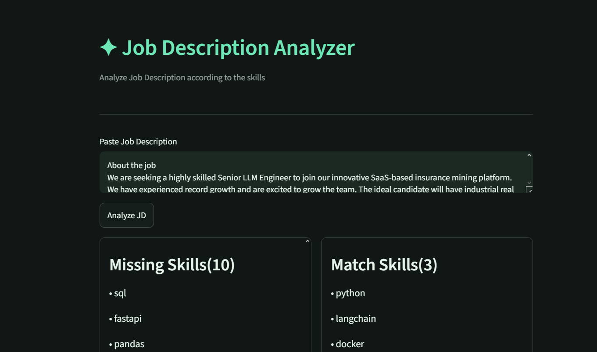
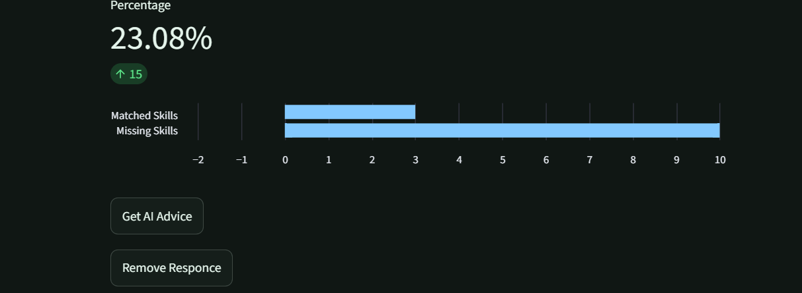

# Job Description Analyzer

An AI-powered web application that analyzes job descriptions, identifies matching and missing skills, calculates a skill match percentage, and uses Google's Gemini AI to provide personalized recommendations.


## Preview





## Live Demo

🔗 **Live App:** [Open Job Description Analyzer](https://jobanalyzer-d3dvddrdhrehwj2t63nwfb.streamlit.app/)

## Features

- **Skill Matching:** Identifies skills found in a job description.
- **Missing Skills Analysis:** Highlights skills that may need improvement.
- **Match Percentage:** Calculates the percentage of matched skills from a predefined skill list.
- **AI-Powered Recommendations:** Uses Google Gemini to generate suggestions for improving relevant skills.
- **Interactive UI:** Simple interface built with Streamlit.

## Tech Stack

- Python
- Streamlit
- Google Gemini API
- Pandas
- Python-dotenv

## Getting Started

### 1. Clone the Repository

```bash
git clone https://github.com/MuhammadTalhaAsif002/Job_Analyzer.git
cd Job_Analyzer
```

### 2. Create a Virtual Environment

```bash
python -m venv .venv
```

Activate it on Windows:

```bash
.venv\Scripts\activate
```

### 3. Install Dependencies

```bash
pip install -r requirements.txt
```

### 4. Configure Your Gemini API Key

Create a `.env` file in the project root:

```env
GEMINI_API_KEY=your_gemini_api_key
```

Get an API key from [Google AI Studio](https://aistudio.google.com/apikey).

**Security:** Never commit your `.env` file or expose your API key publicly.

### 5. Run the Application

```bash
streamlit run app.py
```

The application will open in your browser.

## Deployment

The application can be deployed using [Streamlit Community Cloud](https://share.streamlit.io/).

For deployment, configure the following secret in your app's Streamlit Cloud settings:

```toml
GEMINI_API_KEY = "your_gemini_api_key"
```

## How It Works

1. The user pastes a job description.
2. The application compares the text against a predefined list of skills.
3. It displays matching skills, missing skills, and the match percentage.
4. Gemini AI generates recommendations based on the job description and skill analysis.

## Current Limitations

- Skill matching uses predefined keywords rather than semantic understanding.
- The match percentage reflects the predefined skill list, not the candidate's complete suitability for a job.
- AI recommendations depend on Gemini API availability and usage limits.

## Future Improvements

- Resume upload and resume-to-job matching.
- Semantic skill matching using embeddings.
- Job-specific skill extraction.
- Skill prioritization based on job requirements.
- Downloadable analysis reports.

## Author

**Muhammad Talha Asif**

[GitHub Profile](https://github.com/MuhammadTalhaAsif002)
